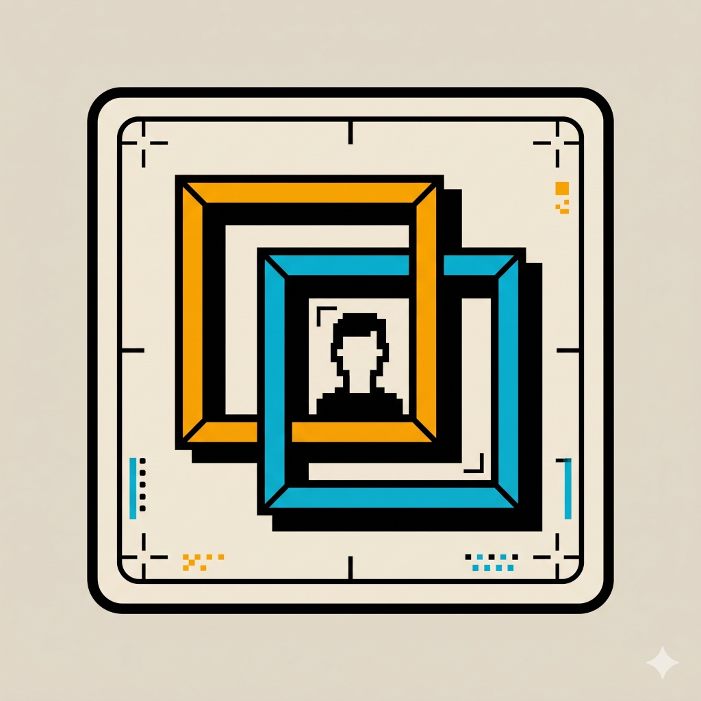
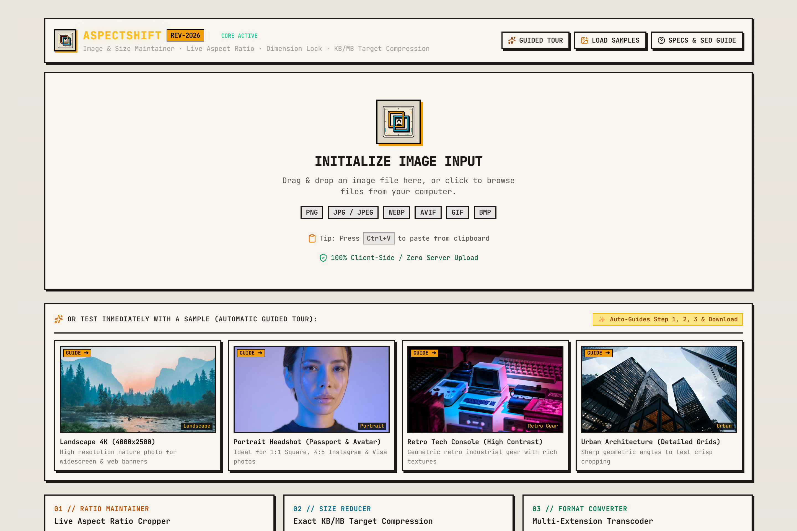
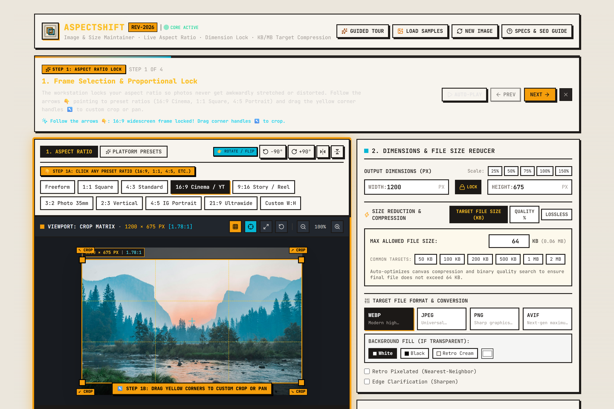
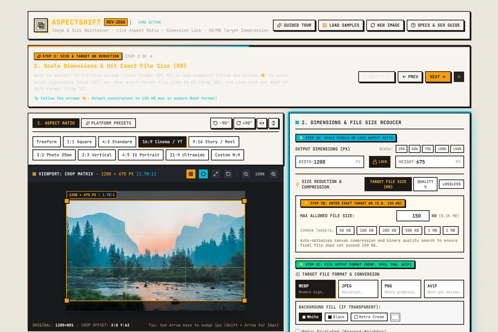
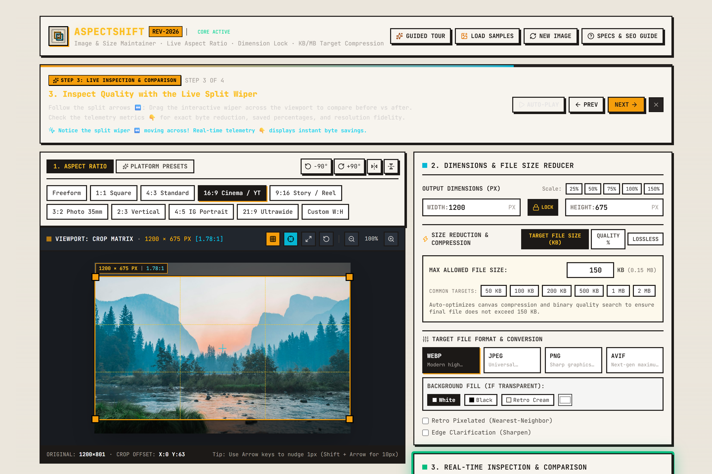
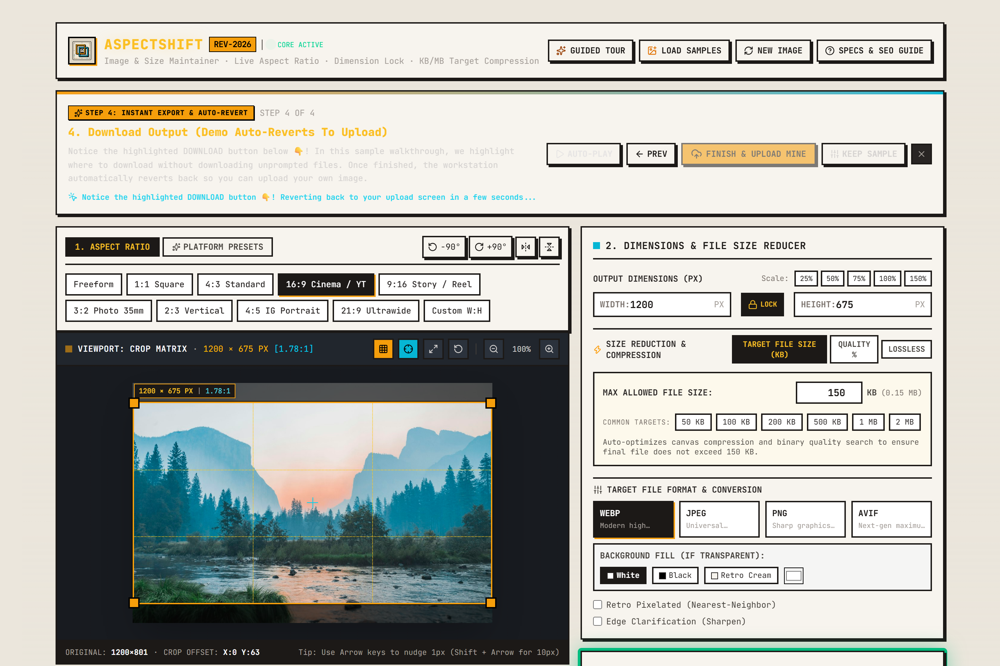

<div align="center">

  

  # 📐 AspectShift Workstation
  ### Professional Aspect Ratio Maintainer, Target-KB Compressor & Live Inspection Suite

  <p align="center">
    <strong>A high-performance, 100% client-side image workstation built with Angular 21 and a neo-retro terminal aesthetic.</strong><br>
    Eliminates image distortion, locks proportional aspect ratios, and compresses photos to exact file size limits (KB) with automated binary search quality tuning.
  </p>

  <p align="center">
    
    
    
    
    
    
  </p>

  <p align="center">
    <a href="#-the-problem-aspectshift-solves">Problem Solved</a> •
    <a href="#-core-services--features">Core Services</a> •
    <a href="#-visual-tour-of-services-screenshots">Visual Showcase</a> •
    <a href="#-how-this-project-was-engineered-junior-developer-perspective">How It Was Developed</a> •
    <a href="#-tech-stack--architecture">Architecture</a> •
    <a href="#-getting-started">Run Locally</a>
  </p>

</div>

---

## 💡 The Problem AspectShift Solves

When users upload photos for **job portals, official visas, university admissions, and social media platforms**, they frequently encounter two frustrating obstacles:

1. **Awkward Stretching & Distortion:** Most naive image resizing stretches the width or height independently, distorting facial features and key subject matter.
2. **Arbitrary File Size Budgets:** Portals often enforce strict rules (e.g., *"Must be under 200 KB and exactly 1:1 or 16:9"*). Traditional tools force users to guess arbitrary quality percentage sliders (`80%`, `60%`, `45%`), re-uploading repeatedly until they sneak under the limit.
3. **Data Privacy Concerns:** Uploading sensitive personal documents (passports, resumes, ID photos) to random cloud compressors exposes private data to third-party servers.

**AspectShift eliminates all three problems** by executing 100% within the user's browser using HTML5 Canvas matrices and automated binary search algorithms. Zero images ever leave the device.

---

## 🛠️ Core Services & Features

| Service | Description | Key Capabilities |
| :--- | :--- | :--- |
| **1. Ingestion Engine** | Frictionless drag-and-drop, file browsing, and clipboard paste. | Drag & drop, `Ctrl+V` paste, 4 curated local test presets (Landscape, Portrait, Retro Tech, Architecture). |
| **2. Aspect Ratio Maintainer** | Locks proportional framing to guarantee zero stretching. | 1:1, 16:9 Cinema, 4:5 Portrait, 9:16 Reel, 21:9 Ultrawide, 4:3, 3:2, and custom `W:H` inputs. |
| **3. Precision Crop Matrix** | Visual canvas viewport with interactive composition guides. | 8 retro corner/edge handles, rule-of-thirds grid, center crosshair, 1px keyboard nudging, zoom & pan. |
| **4. Orientation Controls** | Instant non-destructive spatial orientation transforms. | 90° Clockwise / Counter-Clockwise rotation, Horizontal & Vertical mirror flipping. |
| **5. Target-KB Compressor** | Automated binary-search compression to hit exact file budgets. | Set exact KB limit (e.g., `150 KB`), automated matrix optimization, lossless precision mode, quality slider. |
| **6. Multi-Format Transcoder** | Converts images to modern, high-efficiency web formats. | WebP, AVIF, JPEG, PNG, transparent background fill (White, Black, Retro Cream, custom Hex). |
| **7. Live Split Wiper** | Interactive real-time comparison between original and output. | Interactive split-slider wiper, side-by-side mode, instantaneous visual fidelity verification. |
| **8. Real-Time Telemetry** | Technical metrics on byte savings and performance. | Exact byte sizes, size reduction percentage, output resolution, and canvas execution latency. |
| **9. Guided Interactive Tour** | Automated step-by-step walkthrough with directional arrows. | Visual callout badges, animated arrows, step controls, auto-play, and intelligent demo reversion. |

---

## 📸 Visual Tour of Services (Screenshots)

### 1. Ingestion & Preloaded Sample Suite
The landing screen features a neo-retro brutalist terminal with an animated 3D perspective grid, instant drop zone, file picker, clipboard paste listener, and offline sample presets for immediate one-click testing.



---

### 2. Live Aspect Ratio Locking & Precision Crop Matrix
Selecting a preset (such as 16:9 or 1:1) locks the crop boundary proportionally. Users can drag the corner handles, pan the crop area, rotate the photo, or use the Rule-of-Thirds grid to align their subject with zero distortion.



---

### 3. Binary Search Target File Size Reducer (KB) & Format Transcoder
Instead of manually guessing compression settings, enter your exact maximum allowed file size (e.g. `150 KB`). The internal binary search engine automatically converges on the ideal canvas quality matrix while maintaining crisp visual clarity.



---

### 4. Interactive Split Wiper & Real-Time Telemetry
Drag the retro split wiper handle back and forth across the viewport to compare the uncompressed original with the compressed output. The telemetry dashboard reports exact byte savings, compression ratios, and processing latency in real time.



---

### 5. Zero-Server Instant Export & Automated Guided Tour
Once satisfied, click the highlighted **DOWNLOAD** button to export your file instantly. In demo mode, the workstation guides users through every option with animated arrows and automatically resets to the upload screen once complete.



---

## 🚀 How This Project Was Engineered (Junior Developer Perspective)

As a junior developer, building AspectShift was an exercise in mastering **modern web standards, reactive frontend architecture, and browser performance optimization**. Here are the key technical challenges tackled and architectural patterns implemented:

### 1. Standalone Angular 21 Architecture
* Migrated from a legacy React prototype to a modern **Angular 21 standalone component architecture** without `NgModule` boilerplate.
* Implemented clean component boundaries:
  * [`RetroHeaderComponent`](file:///d:/AspectRatioProject/src/app/components/retro-header/retro-header.component.ts): Global workstation navigation and sample loader.
  * [`ImageUploaderComponent`](file:///d:/AspectRatioProject/src/app/components/image-uploader/image-uploader.component.ts): File input, drag-and-drop, and preset cards.
  * [`AspectPresetBarComponent`](file:///d:/AspectRatioProject/src/app/components/aspect-preset-bar/aspect-preset-bar.component.ts): Ratio buttons, custom ratio inputs, and rotate/flip controls.
  * [`InteractiveCropperComponent`](file:///d:/AspectRatioProject/src/app/components/interactive-cropper/interactive-cropper.component.ts): Interactive SVG/Canvas crop matrix with drag handles and coordinate math.
  * [`SizeTargetPanelComponent`](file:///d:/AspectRatioProject/src/app/components/size-target-panel/size-target-panel.component.ts): Dimension scaling, target KB binary search inputs, and format toggles.
  * [`ComparisonPreviewComponent`](file:///d:/AspectRatioProject/src/app/components/comparison-preview/comparison-preview.component.ts): Real-time before/after split wiper slider and telemetry analytics.
  * [`GuidedTourComponent`](file:///d:/AspectRatioProject/src/app/components/guided-tour/guided-tour.component.ts): Interactive HUD banner controlling automated walkthrough steps.

### 2. Binary Search Quality Optimization Algorithm
Traditional image compression requires users to repeatedly slide a quality percentage and check the file size. In [`src/app/utils/image-processor.ts`](file:///d:/AspectRatioProject/src/app/utils/image-processor.ts), I engineered an automated binary search algorithm:
* **The Logic:** Given a target limit $T$ in KB, the algorithm tests the midpoint $Q = \frac{\text{low} + \text{high}}{2}$ on an offscreen HTML5 `<canvas>`.
* If the exported byte length exceeds $T$, $\text{high} = Q$. If it is below $T$, $\text{low} = Q$.
* It converges within 6 to 7 iterations (under 80ms), ensuring the resulting image is as close as possible to the target limit without ever exceeding it.
* If the image still exceeds the target size at lowest quality, it applies intelligent dimensional downscaling proportionally.

### 3. Memory Safety & Zero-Leak Architecture
* Early prototypes created `URL.createObjectURL(blob)` on every slider tick, causing gradual memory leaks and browser bloat.
* Refactored the entire rendering pipeline to use **Base64 Data URLs** via `canvas.toDataURL()` and `FileReader.readAsDataURL()`.
* Debounced input events with a 120ms throttle to prevent UI lag during rapid cropping handle adjustments.
* Cleaned up all active timers and event listeners (`mousemove`, `mouseup`, `setInterval`) inside `ngOnDestroy`.

### 4. Zero-CORS Local Asset Serving
* External Unsplash demo images often suffer from `Access-Control-Allow-Origin` (CORS) security restrictions when drawn onto an HTML5 canvas (`SecurityError: The operation is insecure`).
* Downloaded and packaged all sample assets locally in [`public/samples/`](file:///d:/AspectRatioProject/public/samples/) so the demo operates 100% offline with zero remote dependencies.

### 5. Smart Guided Tour State Machine
* Users who test a preloaded sample are provided a step-by-step walkthrough. Once finished, the workstation **automatically reverts back to the initial upload screen** so they can upload their own photo.
* If a user uploads their **own photo** and triggers the tour, the workstation guides them through their photo, and when finished, **preserves their photo and settings** without forcing a re-upload.

---

## 📂 Tech Stack & Architecture

```
AspectRatioProject/
├── public/
│   ├── favicon.png                  # Neo-retro workstation icon
│   ├── logo.png                     # Custom application logo
│   └── samples/                     # Zero-CORS offline demo assets
│       ├── landscape-nature.jpg     # 16:9 Widescreen sample
│       ├── portrait-headshot.jpg    # 1:1 & 4:5 Avatar sample
│       ├── retro-tech-console.jpg   # 4:3 Technical sample
│       └── urban-architecture.jpg   # 3:2 Architecture sample
├── src/
│   ├── app/
│   │   ├── components/
│   │   │   ├── aspect-preset-bar/   # Aspect ratio presets, rotate & flip
│   │   │   ├── comparison-preview/  # Split wiper slider & live telemetry
│   │   │   ├── guided-tour/         # Step-by-step HUD controller
│   │   │   ├── image-uploader/      # Drag & drop upload zone
│   │   │   ├── interactive-cropper/ # Viewport crop matrix & handles
│   │   │   ├── retro-header/        # Workstation navigation header
│   │   │   ├── seo-guide-section/   # Knowledge base & FAQs
│   │   │   └── size-target-panel/   # Dimension scaler & target KB optimizer
│   │   ├── utils/
│   │   │   ├── image-processor.ts   # Canvas rendering & binary search compression
│   │   │   └── presets.ts           # Aspect ratio & social platform specs
│   │   ├── types.ts                 # Strongly typed TypeScript interfaces
│   │   └── app.ts                   # Root application component & state coordinator
│   ├── index.html                   # HTML entry point with metadata
│   ├── main.ts                      # Application bootstrap
│   └── styles.css                   # Tailwind CSS v4 styling & custom retro utilities
├── docs/
│   └── screenshots/                 # High-resolution documentation screenshots
├── scripts/
│   └── capture-screenshots.js       # Automated Puppeteer screenshot generator
├── angular.json                     # Angular CLI configuration
├── package.json                     # Project dependencies & scripts
├── tsconfig.json                    # TypeScript compiler options
└── vercel.json                      # Vercel deployment routing configuration
```

---

## ⚡ Getting Started

### Prerequisites
* **Node.js** (v18.x, v20.x, or newer recommended)
* **npm** (v9.x or newer)

### Installation

```bash
# 1. Clone the repository
git clone https://github.com/your-username/aspect-shift.git

# 2. Navigate to project root
cd aspect-shift

# 3. Install dependencies
npm install
```

### Running Locally

```bash
# Start the development server
npm run dev
# or
npm start
```

Open your browser and navigate to:
```
http://localhost:4200/
```

### Production Build

```bash
# Compile optimized production bundle
npm run build
```
The production assets are generated in `dist/aspect-shift-angular/browser`.

---

## ☁️ Deployment (Vercel)

The project includes a ready-to-use [`vercel.json`](file:///d:/AspectRatioProject/vercel.json) configured for single-page application (SPA) routing:

```json
{
  "version": 2,
  "buildCommand": "npm run build",
  "outputDirectory": "dist/aspect-shift-angular/browser",
  "routes": [
    { "handle": "filesystem" },
    { "src": "/(.*)", "dest": "/index.html" }
  ]
}
```

Deploy in one command with the Vercel CLI:
```bash
vercel --prod
```

---

## 🗺️ Roadmap & Future Enhancements

- [x] Standalone Angular 21 Architecture with Neo-Retro Terminal Theme
- [x] Proportional Aspect Ratio Locking (16:9, 1:1, 4:5, 9:16, 21:9, Custom)
- [x] Target File Size Binary Search Compression (Exact KB Budget)
- [x] Real-Time Before/After Split Wiper Slider with Live Telemetry
- [x] Interactive Guided Tour with Animated Directional Arrows
- [x] Smart Reversion Logic (Demo samples auto-revert; user uploads persist)
- [ ] Batch processing for multiple images simultaneously
- [ ] WebAssembly (Wasm) SIMD-accelerated canvas filters
- [ ] Progressive Web App (PWA) offline installation support

---

## 📄 License

This project is open-source and available under the [MIT License](LICENSE).

---

<div align="center">
  <sub>Built with ❤️ and dedication by a passionate Junior Frontend Developer exploring Angular 21 and modern web performance.</sub>
</div>
